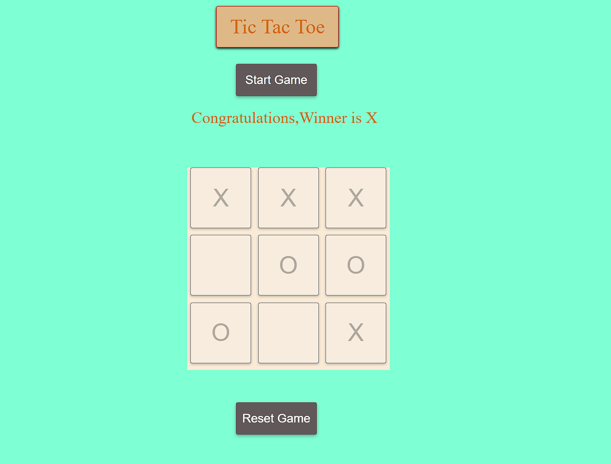

# Tic Tac Toe Game

Welcome to the **Tic Tac Toe** game! This is a classic two-player game where players take turns marking a space in a 3x3 grid. The first player to get three of their marks in a row (horizontally, vertically, or diagonally) wins the game.

## Table of Contents
- [Tic Tac Toe Game](#tic-tac-toe-game)
  - [Table of Contents](#table-of-contents)
  - [Features](#features)
  - [How to Play](#how-to-play)
  - [Getting Started](#getting-started)
  - [Demo](#demo)
  - [Technologies Used](#technologies-used)
  - [Contact](#contact)

## Features
- Interactive gameplay for two players.
- Restart and reset options available.
- Visually appealing interface with responsive design.

## How to Play
1. Click on the **Start Game** button to begin.
2. Players take turns clicking on the empty squares to place their marks (X or O).
3. The game ends when a player gets three marks in a row, or if the game ends in a draw.
4. Use the **Reset Game** button to start a new game.

## Getting Started
To run the game on your local machine, follow these steps:

1. Clone the repository:  
   git clone https://github.com/yourusername/tic-tac-toe.git

2. Navigate to the project directory:  
 cd tic-tac-toe

3. Open the index.html file in your web browser.

## Demo

## Technologies Used
HTML  
CSS  
JavaScript 

## Contact
For any inquiries or suggestions, please reach out to:

Almas Forhadi  
almasforhasi1999@gmail.com  
   
